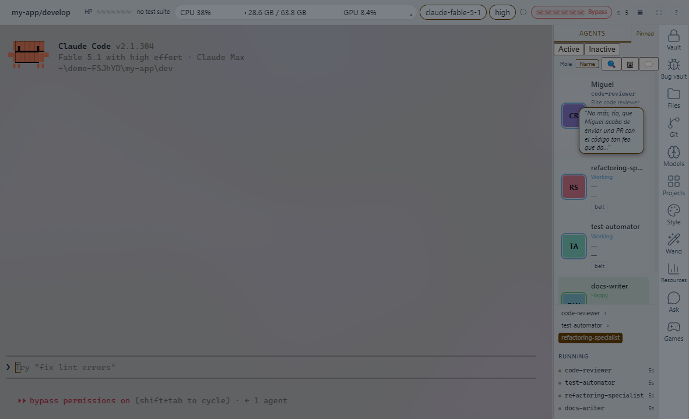
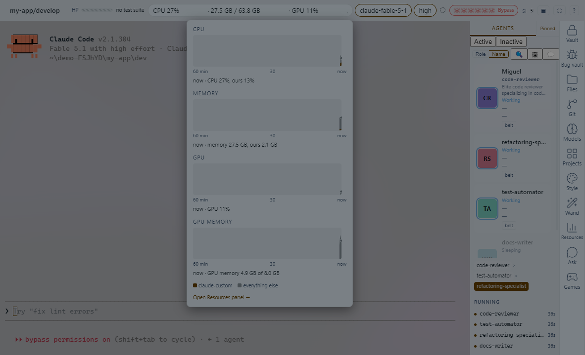

# claude-custom

A Windows desktop cockpit for Claude Code. It runs the real `claude` command-line program inside a terminal window and puts panels around it: who's working, what the machine is doing, what your quota looks like, what's in the repo.

The founding bet is that it wraps the CLI and never reimplements it. The window is Electron with xterm.js and node-pty, and `claude` runs in a pty exactly as it would in any terminal. Only the display changes. Anything that belongs to the `claude` process (Remote Control, MCP servers, hooks, `--resume`, skills, plugins, background tasks) keeps working, because nothing in between has replaced it.





## Platforms

Windows 10 and 11 only, for now. The host is plain Node and node-pty runs elsewhere, but the hook helper is a Windows executable and the CPU and memory samplers are PowerShell. There's no macOS or Linux build, and nothing here has been run on either.

## Requirements

- Windows 10 or 11.
- Node.js 22 or newer, to run from source. It's developed on Node 24.
- The `claude` CLI installed and signed in. Install it with `npm install -g @anthropic-ai/claude-code`, then run `claude` once in a terminal and log in. It's built and checked against 2.1.x.
- To rebuild the hook helper from source: the .NET 10 SDK and the Visual Studio C++ build tools, because the helper is compiled ahead of time to a native executable. You don't need either if you use the installer, which ships a built helper.
- Optional: [Ollama](https://ollama.com) running locally. Only the Ask panel and the local-model summaries and speech bubbles use it.

## Install

There's no published installer yet. You can build one yourself, or run from source.

**Build the installer.** This takes a few minutes and doesn't sign anything, so Windows SmartScreen will warn when you run it.

```
npm ci
npm run build:helper
npm run dist
```

The installer is `dist\claude-custom-setup-0.0.1.exe`, about 87 MB, and `dist` also gets a zip of the same app. It installs per user, under `%LOCALAPPDATA%\Programs\claude-custom`, and the installer doesn't offer another folder: the app keeps its state (token, log, saved layout) in a `.harness` folder beside its code, and that has to be somewhere you can write to. An update replaces the folder, so a saved layout and the log don't survive one yet.

An installed copy opens the folder you start it in, or the folder you name:

```
& "$env:LOCALAPPDATA\Programs\claude-custom\claude-custom.exe" C:\path\to\your\project
```

If you start it from the Start menu it opens your home folder, and you can switch with the Projects panel. A folder that doesn't exist is refused with one line and no window. `claude-custom.exe --version` prints `claude-custom 0.0.1`, the same line the launcher prints. `--stop` is the launcher's: the exe refuses it.

**Run from source.**

```
npm ci
npm run build:helper
node bin/claude-custom.js C:\path\to\your\project
```

With no folder, the launcher opens the one you're standing in. `node bin/claude-custom.js --help` lists the rest, including `--stop`, which stops the sessions using a folder so you can delete it. `npm start` runs the app on the checkout's own folder, which is mostly useful when you're working on claude-custom itself.

If you'd rather not build the helper, copy `hook-helper.exe` from an installed copy (`resources\app\.harness\`) into the checkout's `.harness\` folder.

## What it does

Panels sit in a rail on the right and can be docked, moved, floated or hidden. The names below are the tab names in the app.

**Agents and sessions**

- **Agents** shows the subagents Claude starts, who's working and on what, with a character for each one. It needs the hook helper.
- A project laid out as `<root>\dev` plus a sibling folder per git worktree opens as one window with a tab per worktree. Any other folder opens as a single tab. A session lives in its own host process, so closing the window doesn't end it, and reopening the window reattaches.
- The top bar carries a project-health bar fed by your test suite when it has a recognisable one (click it to run it), and quota meters for the 5-hour and weekly windows.
- **Claude's panel** is a page Claude builds for the session, when you ask it to. It also needs the hook helper.

**The machine**

- **Resources** shows CPU and memory per session, per project and in total, with a one-hour history. It can stop a runaway child process of a session.
- Per-project looks, including backgrounds, set in **Style**.

**The repo**

- **Files** browses the worktree and opens files for reading and editing. Files Claude touched are marked.
- **Git** draws every branch the project has grown.
- **Projects** switches to another project, each in its own window.
- **Ask** answers where something is in the repo, or explains the code you selected. It uses a local Ollama model, or Haiku or Sonnet on your plan.

**Everything else**

- **Vault** keeps local encrypted secrets, outside the terminal, so nothing in it is ever written to the session.
- **Bug vault** groups recurring defect classes.
- **Models** browses the models OpenRouter offers and seats a council of them.
- **Wand** holds favourite skills as buttons: one click types the command and you press Enter.
- **Games** has three small ones for the wait. They stop when Claude needs you.

## Keyboard

Press F1, or click the `?` button in the top bar, for the shortcuts page. It lists every key the app handles and marks the ones that belong to Claude Code. A few of the common ones:

| Keys | What |
| --- | --- |
| Ctrl+B | Show or hide every panel |
| Ctrl+Shift+F | Focus mode: only the terminal |
| Ctrl+Shift+D | Diagnostics, including the setup checks |
| Ctrl+Tab | Next tab |

## First-run checks

When a session starts, the host checks four things and shows the results under Diagnostics (Ctrl+Shift+D):

1. `claude` runs and is version 2.1.0 or newer.
2. The hook helper exists and starts.
3. Claude Code is signed in: the credentials file holds a Claude login, or the session's environment carries a credential (an API key, an auth token, an OAuth token, or a Bedrock or Vertex switch). It only looks for the login entry's presence, and never logs or stores a token or a key. The result says which mechanism it found.
4. Ollama answers. This one is optional and never raises a warning.

If one of the first three fails you get a single line at the top of the terminal that says what to run. It's never a modal.

## Troubleshooting

**"Hooks are off", or agents never go Active.** The hook helper is missing or won't start. Run `npm run build:helper`, or copy a built `hook-helper.exe` into `.harness\`. The host log (`.harness\host.log`) says so too. Without the helper the terminal still works, but the roster and Claude's panel don't.

**"Claude Code didn't answer".** `claude --version` took longer than 8 seconds, which a cold start under a virus scanner can do. Run it in a terminal to see why.

**`npm run build:helper` fails.** Check that the .NET 10 SDK and the Visual Studio C++ build tools are installed. The script adds the Visual Studio Installer folder to `PATH` for you, because a missing `vswhere.exe` makes the native compile fail with an error that names the linker.

**"Claude Code isn't installed" and it is.** The app starts `claude.exe` from the npm global folder or `~\.local\bin`, then falls back to `claude.exe` on `PATH`. A shim that's only a `.cmd` file isn't found. Set `CLAUDE_CUSTOM_BIN` to the full path of the executable to override it.

**Port in use.** Each folder gets its own port, derived from its path, and the window steps past a busy one. A port you set yourself with `CLAUDE_CUSTOM_PORT` is never stepped: if something else holds it, that launch refuses. Unset the variable to go back to the derived port.

**`npm test` waits.** The suite takes a machine-wide lock, so several runs can't pin the CPU at once. If the lock script isn't on your machine it says so once and runs anyway. See [CONTRIBUTING.md](CONTRIBUTING.md).

## Not in this version

Auto-update, code signing, macOS and Linux builds, and a website. The installer isn't signed.

## Licence

None yet. All rights reserved for now.

## Built with Claude Code

Most of this was written with Claude Code, under review and test gates described in [CONTRIBUTING.md](CONTRIBUTING.md).
